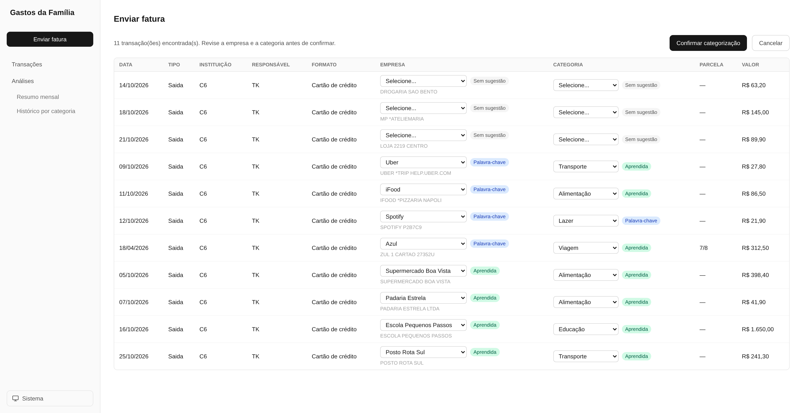
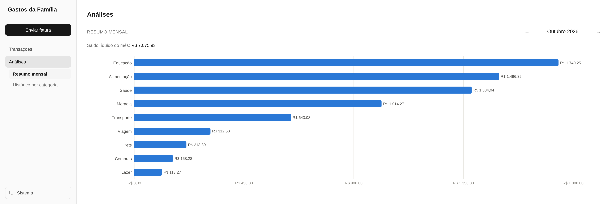
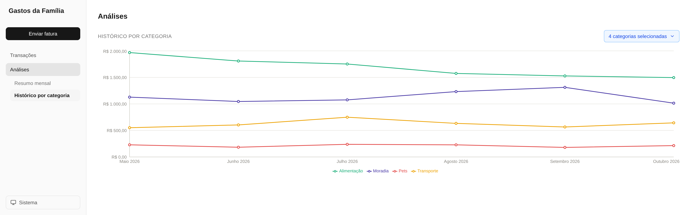

# Family expenses tracking

## Summary
An easy-to-use personal app for tracking family expenses, helping us stay financially healthy and plan for future costs as our family grows. I built it the way I'd build any product as a PM, using AI as a design, engineering and operations partner. With the app, we cut food delivery spending by 40% (3-month average, before vs. after) and worked with our financial advisor on a full assessment of where we stand and what we need to do to reach our goals.

## Screenshots
(Fictional data)


*Transaction review: review transactions before registering them*


*Monthly summary: each category's monthly net balance*


*Category history: historical evolution of each category's net balance*

## Full project
To learn more about the discovery process, the design decisions, the iteration with real data and its results, check out:
* [English version](https://succinct-spectacles-e4c.notion.site/Project-Family-expenses-tracking-406ee8fb5403805ba044d6a91a08620d?source=copy_link)
* [Portuguese version](https://succinct-spectacles-e4c.notion.site/Projeto-Controle-de-gastos-familiar-406ee8fb54038053a3a2dc6074537096?source=copy_link)

## Stack
* Next.js
* TypeScript
* Tailwind CSS
* local JSON
* papaparse
* recharts

## How to run it
Prerequisite: Node.js 20.9 or later (installing via nvm is recommended)

```bash
# 1. Clone the repository
git clone https://github.com/thiagokang/controle-gastos-familia.git
cd controle-gastos-familia

# 2. Install dependencies
npm install

# 3. Run the development server
npm run dev
```

Then open http://localhost:3000/transacoes in your browser.

Optional: measure how well the app identifies companies (run it in a new terminal, after importing at least two months of data):
```bash
npm run eval:empresa
```

Results are saved in `data/evals/`.

Note: all data is saved locally in JSON files (`data/` folder), which aren't tracked by Git because they contain sensitive information. These files are created automatically the first time you run the app.
